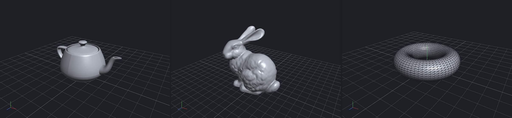

# 3D Model Viewer, written from scratch

**Homework: "Make your own visualizer"** (camera module, object loader, mouse manipulation) plus a
one-page report on recent 3-D technology.
Darin Johnson, October 2026.

A desktop 3-D viewer written in Python. Every graded part is hand-written in this repository: the
camera matrices, the file parsers and the mouse interaction. The only libraries are `numpy` (arrays),
`PyOpenGL` (raw OpenGL bindings, no scene graph) and `glfw` (opens the window and delivers mouse and
keyboard events). No viewer or geometry library such as Open3D, trimesh, pyrender or three.js is used.



*Left to right: the Utah teapot, the Stanford bunny and a wireframe torus, each with the ground grid
and the orientation gizmo in the corner.*

## Where each requirement is implemented

| Requirement | File | Main functions | Tests |
|-------------|------|----------------|-------|
| **1. Camera module** | [`viewer/camera.py`](viewer/camera.py) | [`look_at`](viewer/camera.py#L35-L49), [`perspective`](viewer/camera.py#L52-L61), [`orthographic`](viewer/camera.py#L64-L71), [`perspective_from_intrinsics`](viewer/camera.py#L74-L91), class [`OrbitCamera`](viewer/camera.py#L104-L221) | [`MatrixTests`, `OrbitCameraTests`](tests/test_core.py#L49-L134) |
| **2. Object loader** | [`viewer/loader.py`](viewer/loader.py), [`viewer/mesh.py`](viewer/mesh.py) | [`load_obj`](viewer/loader.py#L38-L93), [`load_stl`](viewer/loader.py#L112-L133), [`load_ply`](viewer/loader.py#L242-L269), [`load`](viewer/loader.py#L298-L302), class [`Mesh`](viewer/mesh.py#L24-L91) | [`MeshTests`, `LoaderTests`](tests/test_core.py#L181-L268) |
| **3. Mouse manipulation** | [`viewer/controls.py`](viewer/controls.py) | class [`MouseControls`](viewer/controls.py#L23-L63): [`press`](viewer/controls.py#L36-L43), [`move`](viewer/controls.py#L48-L59), [`scroll`](viewer/controls.py#L61-L63) | [`ControlsTests`](tests/test_core.py#L136-L179) |
| Rendering (needed to see anything) | [`viewer/renderer.py`](viewer/renderer.py), [`viewer/shaders.py`](viewer/shaders.py) | [`GpuMesh`](viewer/renderer.py#L63-L99), [`Renderer.draw`](viewer/renderer.py#L207-L224), GLSL Blinn-Phong shaders | |
| Window and events | [`viewer/app.py`](viewer/app.py), [`main.py`](main.py) | [`ViewerApp`](viewer/app.py#L47-L196): GLFW window, callbacks, key shortcuts | |
| Converter | [`convert.py`](convert.py) | OBJ / STL / PLY in any direction, built on the loader | round-trip test |
| **Report** | [`report/report.pdf`](report/report.pdf) ([Markdown source](report/report.md)) | one page: 3-D representations, converters, camera models | |

The full derivation of every formula is in [`docs/HOW_IT_WORKS.md`](docs/HOW_IT_WORKS.md). The three
sections below summarise what each module does and how to see it working.

### 1. Camera module (`viewer/camera.py`)

The camera turns 3-D points into pixels through two matrices that are built by hand:

```
world  --[view matrix V]-->  camera space  --[projection P]-->  clip space  --(divide by w)-->  screen
```

- [`look_at(eye, target, up)`](viewer/camera.py#L35-L49) builds **V**, the extrinsics. The camera's
  right, up and backward axes become the rows of the rotation; the translation moves the eye to the
  origin.
- [`perspective(fov, aspect, near, far)`](viewer/camera.py#L52-L61) builds **P** for a pinhole
  camera (same matrix as `gluPerspective`); [`orthographic`](viewer/camera.py#L64-L71) is the
  parallel-projection alternative, toggled with the `P` key.
- [`perspective_from_intrinsics(fx, fy, cx, cy, ...)`](viewer/camera.py#L74-L91) builds the same
  **P** from a computer-vision intrinsic matrix **K**, and
  [`OrbitCamera.intrinsics()`](viewer/camera.py#L177-L182) /
  [`extrinsics()`](viewer/camera.py#L184-L187) go the other way, so the viewer's camera is exactly a
  calibrated pinhole camera **x = K [R | t] X**.
- [`OrbitCamera`](viewer/camera.py#L104-L221) is the interactive camera. Its state is a target point,
  a distance and two angles (yaw, pitch). [`position`](viewer/camera.py#L147-L152) converts those
  spherical coordinates into the eye position, [`view_matrix`](viewer/camera.py#L154-L155) and
  [`projection_matrix`](viewer/camera.py#L169-L175) produce **V** and **P** every frame, and
  [`fit`](viewer/camera.py#L210-L221) frames a model by placing the camera at
  `distance = 1.15 * radius / sin(fov / 2)` so its bounding sphere just fills the view.
  [`near_far`](viewer/camera.py#L162-L167) picks the clip planes around the model so depth precision
  is not wasted.

Where it is used: `ViewerApp` creates one camera ([`app.py`](viewer/app.py#L66-L67)) and the renderer
asks it for **V** and **P** each frame ([`renderer.py`](viewer/renderer.py#L207-L224)).

### 2. Object loader (`viewer/loader.py`, `viewer/mesh.py`)

The object loader reads a 3-D model file from disk and converts it into the arrays the GPU can draw:
an `(N, 3)` array of vertex positions, an `(M, 3)` array of triangle indices and an `(N, 3)` array of
normals, stored in the [`Mesh`](viewer/mesh.py#L24-L91) class. Three file formats are parsed without
any external library:

- [`load_obj`](viewer/loader.py#L38-L93): Wavefront OBJ. Reads `v`, `vn` and `f` records, accepts
  every face token form (`v`, `v/vt`, `v//vn`, `v/vt/vn`) and negative indices, fan-triangulates
  polygons with more than three corners, and merges OBJ's separate position and normal index spaces
  into the single index the GPU needs (`np.unique` over `(position, normal)` pairs).
- [`load_stl`](viewer/loader.py#L112-L133): STL, binary (parsed with a numpy structured dtype) and
  ASCII (regex). STL stores loose triangles, so identical corners are **welded** into shared vertices
  ([`_weld`](viewer/loader.py#L20-L23)); this is what makes smooth shading possible.
- [`load_ply`](viewer/loader.py#L242-L269): Stanford PLY, ASCII and binary (both endians). The
  header is parsed into element and property descriptions
  ([`_parse_ply_header`](viewer/loader.py#L165-L186)) which drive the body readers.
- [`load`](viewer/loader.py#L298-L302) dispatches on the file extension; `save_obj`, `save_stl`
  and `save_ply` write the same formats, which is what [`convert.py`](convert.py) uses.
- Files without normals get them from
  [`Mesh.compute_vertex_normals`](viewer/mesh.py#L72-L85): the area-weighted average of the adjacent
  face normals, computed with `np.bincount` instead of a Python loop.

The complete path of a model through the program is
[`ViewerApp.load`](viewer/app.py#L83-L92): `loader.load` → `mesh.ensure_normals()` →
[`GpuMesh`](viewer/renderer.py#L63-L99) (one interleaved vertex buffer + index buffer on the GPU) →
`camera.fit(*mesh.bounds())`. The Stanford bunny (69,451 triangles) loads in about half a second.

To see it: run `python main.py models/bunny.obj`, or drag any `.obj` / `.stl` / `.ply` file onto the
window. `python convert.py models/teapot.obj teapot.stl` exercises the writers.

### 3. Mouse manipulation (`viewer/controls.py`)

[`MouseControls`](viewer/controls.py#L23-L63) receives raw press / move / release / scroll events
and turns pixel movements into camera operations. It does not know about the windowing library, so
it is unit-tested directly; [`app.py`](viewer/app.py#L105-L116) forwards GLFW's callbacks to it.

| Input | Camera operation | Formula ([`move`](viewer/controls.py#L48-L59), [`scroll`](viewer/controls.py#L61-L63)) |
|-------|------------------|----------|
| left drag | [`orbit`](viewer/camera.py#L190-L193): change yaw and pitch | one window height of dragging = one full turn (`2π / height` radians per pixel); pitch is clamped to ±89° so the camera never flips |
| right / middle drag, or Shift + left drag | [`pan`](viewer/camera.py#L195-L204): slide the target in the screen plane | pixels are converted to world units at the target's depth, `2 · distance · tan(fov/2) / height`, so the model follows the cursor exactly |
| wheel | [`dolly`](viewer/camera.py#L206-L208): change the distance | `distance *= 0.9^steps`, exponential so every notch feels the same |

### Report

[`report/report.pdf`](report/report.pdf) is the one-page report on recent technology in the three
requested areas: 3-D representation (NeRF, Gaussian splatting, feed-forward generators such as
TRELLIS and SHARP), converters (glTF, OpenUSD Core Specification 1.0, `KHR_gaussian_splatting`,
representation-to-representation conversion) and camera models (pinhole and distortion models,
learnable cameras, ray-based parameterisations, pose-free reconstruction such as VGGT and
MapAnything). The Markdown source is [`report/report.md`](report/report.md).

## Running it

```bash
pip install -r requirements.txt
python main.py                      # opens models/teapot.obj
python main.py models/bunny.obj     # any .obj / .stl / .ply
python main.py model.stl --ortho    # start in orthographic projection
```

Requires Python 3.9+ and a graphics driver with OpenGL 3.3 (any desktop or laptop from the last decade,
including macOS, where the forward-compatible core profile is requested automatically).

**Windows, no terminal needed:** double-click `run.bat` to open the viewer, or drop a model file onto
`run.bat` to open that model. The script installs the requirements on first use and keeps the window
open if something fails so the error can be read.

### Controls

| Input | Action |
|-------|--------|
| left drag | rotate (orbit around the model) |
| right or middle drag, or Shift + left drag | pan |
| mouse wheel | zoom (dolly towards the target) |
| `R` / `F` | reset the view / re-fit the model |
| `W` | cycle solid, solid + wireframe, wireframe |
| `S` | smooth / flat shading |
| `P` | perspective / orthographic |
| `G` / `A` | toggle the ground grid / axes and gizmo |
| `C` | save a screenshot to `screenshots/` |
| `H` | print this help in the terminal |
| drag a file onto the window | load it |
| `Esc` or `Q` | quit |

## Rendering

Not a graded requirement, but the viewer needs it to show anything. Positions and normals are
interleaved in one vertex buffer object; the vertex shader applies **P · V · M** and the fragment
shader computes Blinn-Phong lighting from a headlight fixed to the camera
([`viewer/shaders.py`](viewer/shaders.py)). Flat shading uses screen-space derivatives (`dFdx`,
`dFdy`) of the eye-space position, wireframe overlay uses polygon offset, and the corner gizmo is
drawn with a rotation-only copy of the view matrix in a small viewport
([`_draw_gizmo`](viewer/renderer.py#L226-L236)).

## Converter

```bash
python convert.py models/teapot.obj teapot.stl          # binary STL
python convert.py teapot.stl teapot.ply --binary        # binary PLY with computed normals
python convert.py teapot.ply teapot.obj --no-normals
python convert.py some_mesh.ply --info                  # statistics only
```

## Tests

```bash
python -m unittest discover tests
```

23 tests cover the matrix maths (look-at, perspective, equivalence with the intrinsic matrix, pixel
projection), the orbit camera (fit, pixel-exact panning, clamps, reset), the mouse controls, normal
computation, and a round trip of a cube through every supported file format. They run without an
OpenGL context. `python main.py model.obj --screenshot out.png --hidden` renders one frame
off-screen, which is how the screenshots in `docs/` were produced.

## Project layout

```
main.py                 entry point (argument parsing, default model)
convert.py              format converter CLI
run.bat                 Windows double-click launcher
viewer/
  camera.py             1. camera module: matrices + OrbitCamera
  loader.py             2. object loader: OBJ / STL / PLY readers and writers
  mesh.py                  Mesh container, bounds, normals
  controls.py           3. mouse manipulation
  renderer.py              OpenGL buffers, shaders, grid, axes, gizmo, screenshots
  shaders.py               GLSL sources
  app.py                   GLFW window, callbacks, main loop
models/                 sample models (teapot, bunny, cube, sphere, torus) + generator
tests/test_core.py      unit tests
docs/HOW_IT_WORKS.md    detailed explanation of the implementation, with derivations
report/                 one-page report (Markdown + PDF)
```

## Limitations and possible extensions

- Materials, textures and vertex colours are ignored; the mesh is drawn in one colour.
- Polygon faces are fan-triangulated, which assumes convex polygons (true for almost all files).
- The parsers are pure Python/numpy: the 70k-triangle bunny loads in about half a second,
  so million-triangle files take several seconds.
- Natural next steps: a trackball (arcball) rotation mode, picking with the inverse projection,
  glTF loading, progressive level-of-detail loading for very large files, and a point-splat renderer
  for Gaussian-splat `.ply` files.
